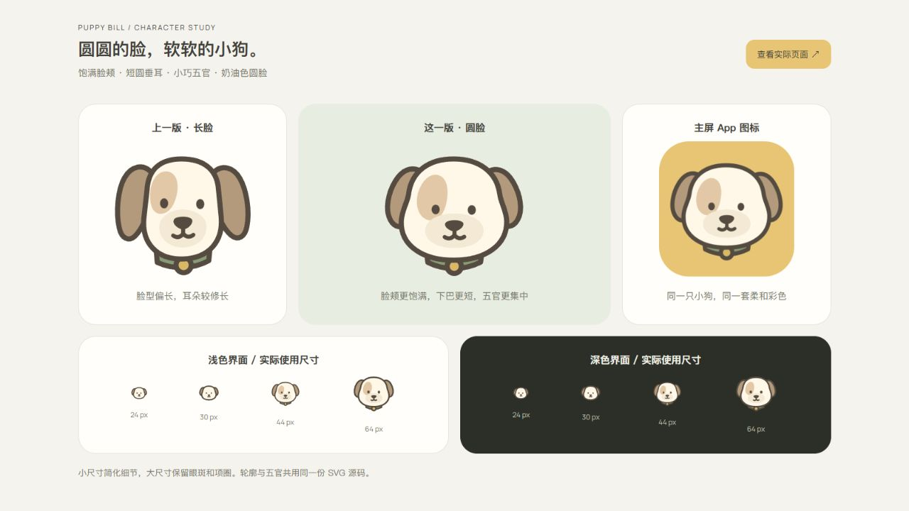

# 小狗账单项目交接

更新日期：2026-10-20。项目目录：`D:\ClaudeWorkSpace\小狗账单`。

项目保留 React PWA，已新增 Capacitor 8 iOS 工程和本地通知验证版。用户确认「先自己使用，稳定后再考虑上架」，已有 Mac 和 iPhone，并已授权接入本地通知。通知设置、每日提醒、待入账提醒、取消/重排和点击导航已实现；尚未在 Mac 上完成 Xcode 编译、签名或 iPhone 真机验收。操作和行为说明见 [IOS.md](IOS.md)。视觉仍为此前确认的柔彩日记与圆脸小狗。

## 本轮接续：GitHub 交付与更新流程

用户已确认按「先上传开发分支 → Mac / iPhone 首次验收 → 再接入 Xcode Cloud / TestFlight」推进，并要求本次进展同步到本文。

- 仓库：[MatrielCool/puppy-bill](https://github.com/MatrielCool/puppy-bill)，当前为公开仓库。远端 `main` 核对为 `8189a1c`；推送 `main` 会触发 Pages 发布。
- 已提交并推送开发分支 [`codex/ios-local-notifications`](https://github.com/MatrielCool/puppy-bill/tree/codex/ios-local-notifications)，阶段代码提交为 `5e3af9a`（`feat: checkpoint journal design, receivables and iOS reminders`）。包含 138 个文件，范围包括待入账与 schema 3、柔彩日记、确认圆脸小狗、Capacitor iOS 工程、本地通知和文档；不要把整个差异归因于这次整理。
- 新增 `.github/workflows/checks.yml`：`main`、`codex/**` 推送及面向 `main` 的 PR 自动执行 lint、测试、图标生成、网页构建和 `npm run ios:sync`。运行于 Ubuntu，只验证代码及 iOS 资源，不做 Xcode 编译或签名。首次推送已触发检查；2026-10-20 00:33（北京时间）核对时仍在等 GitHub 运行机，尚无云端成功结论。最终文档提交会再触发检查并取消同分支尚未完成的旧任务，以[分支最新 Actions 结果](https://github.com/MatrielCool/puppy-bill/actions?query=branch%3Acodex%2Fios-local-notifications)为准。
- Pages 工作流增加 lint/test 门槛。本轮只推送开发分支，已核对远端 `main` 仍为 `8189a1c`；没有合并、创建 PR 或触发 Pages 发布，也未发布手机安装包。
- IOS.md 已改为从 GitHub 开发分支获取代码，并补充 Mac 后续更新命令、覆盖安装和 Xcode Cloud / TestFlight 接入条件。此前「只能复制完整工作区」的说明已不再适用；直接克隆开发分支即可。
- 本轮上传前复核：lint、9 个测试文件 / 99 项测试、网页构建及 iOS 资源同步均通过。
- 尚未完成：Mac Xcode 编译、签名、iPhone 真机验收、共享 Scheme、Apple 账号及 App Store Connect 配置、Xcode Cloud / TestFlight 分发。未开通或购买 Apple 会员。
- 后续日常更新路径：修改功能/设计 → 测试与 GitHub 开发分支 → Mac 拉取并安装；真机稳定后再配置云端构建和 TestFlight 自动更新。GitHub 源码备份与手机账本备份是两回事。

## 上一阶段：iOS 本地通知

- 新增 `src/native/`、`NativeReminderSettings.tsx`、`capacitor.config.ts`、`ios/`、`IOS.md` 及两份提醒测试。
- 通知默认关闭，开启或测试时才申请授权。每日默认 21:00，待入账默认提醒日 09:00，同日合并；已过时间不补发，结清/撤销/延期/删除/导入自动重新核对。
- 设备通知设置用 Preferences 保存，不进入账本备份。账本仍为 Dexie / IndexedDB schema 3，本轮没有迁移 SQLite、改写账本或添加云同步。
- `npm run ios:sync` 生成 `dist-native/` 并同步 iOS；原生模式停用 Service Worker。`npm run build` 仍生成 GitHub Pages PWA。
- 2026-10-20：网页构建、iOS 资源构建及同步、lint 通过；9 个测试文件共 99 项通过（包括应用级通知订阅与点击导航）。沙箱的 Vitest 临时缓存 EPERM 在常规执行环境重跑后通过。
- 设置页隔离预览在 `scratch/reminder-preview.html`，使用内存模拟插件，不读写账本；这不是系统通知验收。
- 下一步在 Mac 按 IOS.md 安装，测试 10 秒通知、锁屏到达和冷启动点击跳转。当前 Bundle Identifier 为开发占位 `com.puppybill.app`，首次安装前确定自己的标识及 Team。
- 本阶段的跨多轮成果纳入本轮开发分支交付；Mac 获取方式以 IOS.md 和上方最新交付状态为准。

## 新对话从这里开始

1. 阅读本文，查看 `git status --short`，保留现有未提交改动。
2. 查看下面的已确认设计和对应截图。不要继续迭代小狗，除非用户再次要求。
3. 打开现有预览；若服务已退出，按本文命令重启。
4. 用户已授权 Capacitor 本地通知接入和 GitHub 开发分支交付，后续先做 Mac / iPhone 验收。SQLite、云同步及其他功能仍需按后续需求推进。

根目录 `AGENTS.md` 和 `README.md` 已指向本文，新对话应首先读取它。

## 用户目标和已确认的取舍

用户最初希望评估现有网页账单工具变成较正式 App 的路径，并改善整体审美。后续明确要求先统一视觉，业务功能保持原样，功能优化之后再讨论。

视觉偏好是有彩色搭配、轻松活泼，但避免刺眼的高饱和撞色。早期的蓝黄波普和亮紫黄方向没有成为最终方案；即使旧的设计选择器仍能切换它们，也不要据此覆盖当前确认结果。字体需要和整体设计协调，不能只换颜色、全页加粗。

参考链接保留在此，方便以后核对风格：

- [用户的 UI 收藏夹](https://www.pinterest.com/matriel_cool/ui/)
- [参考一](https://www.pinterest.com/pin/827536500330292223/)
- [参考二](https://www.pinterest.com/pin/1145181011536591722/)

目前采用直接编写 HTML/CSS 和 SVG，再在真实页面检查的制作路径。尚无必须依赖的 Figma 文件或外部设计插件。用户允许按需安装插件和 skills，但不需要为了接续工作重新安装一套工具。

## 小狗最终采用的版本

**以用户截图中间标为“这一版 · 圆脸”的版本为准。** 这是第一次圆脸调整稿，具有短垂耳、小椭圆眼睛、淡色椭圆口鼻块、一侧眼斑和绿色项圈。它没有眼神光、腮红和双瓣嘴套，也不是后来去掉口鼻块的极简稿。



| 文件 | 用途 |
| --- | --- |
| `src/ui/puppyArtwork.mjs` | 正式图形源，已经恢复到确认版本 |
| `src/ui/puppyArtwork.d.mts` | TypeScript 声明 |
| `design/soft-journal/reference/user-approved-round.jpg` | 用户亲自确认的截图，已从临时附件复制进项目 |
| `design/soft-journal/reference/puppy-approved.svg` | 确认头像的固定矢量基准，恢复后已核对一致 |
| `design/soft-journal/puppy-mark.svg` | 当前大头像独立导出 |
| `design/soft-journal/puppy-small.svg` | 当前小尺寸图标导出 |
| `design/soft-journal/puppy-refinement.html` | 当前预览板，中间标注“已确认 · 圆脸” |
| `design/soft-journal/puppy-approved.png` | 恢复确认版本后的预览截图 |
| `design/soft-journal/puppy-round.png` | 当时圆脸方案的原始截图 |
| `design/soft-journal/puppy-features.png`、`puppy-flat.png` | 后续试验稿，仅供历史对照，不是最终版本 |

图形用 64 × 64 网格编写，再缩放到 24 × 24 viewBox。`Icon.tsx` 在 `dog` / `profile` 且尺寸不小于 40px 时使用详细头像；较小尺寸使用简化版本。页面标题、导航、预算中心和“我的”头像共用该源。

`scripts/icon.mjs` 同样引用该源，`npm run icons` 生成 favicon、Apple touch icon、192/512px PWA 图标及 maskable 图标。`public/` 中这些生成物被 Git 忽略，首次安装依赖后、构建和部署前要重新生成。

```powershell
npm run icons
node design/soft-journal/export-puppy-preview.mjs
```

第二条命令生成独立 SVG 和预览板，脚本及其参考输入都在项目目录内。`scratch/` 中的旧实验脚本可能导出过时文案，不再作为接续入口。

## 已完成的界面工作

五个页面“记一笔、账单、待入账、预算、我的”以及日期选择、预算设置、账目编辑、待入账和到账弹层已经采用同一套视觉。新增统一页头、图标和小狗场景，调整卡片、按钮、导航、键盘、留白及文字层级。该阶段保持现有业务逻辑。

| 设计项 | 当前约定 |
| --- | --- |
| 背景与卡片 | 暖灰白 `#F5F3EE`，卡片 `#FFFEFA` |
| 主色 | 麦芽黄 `#E8C575` |
| 辅色 | 灰玫瑰 `#E8D2CB`、雾薰衣草 `#DCD5E7`、鼠尾草绿 `#CCD7C0` |
| 文字 | 深棕灰 `#414139` |
| 中文 | iOS 苹方优先，Windows 微软雅黑，其他设备系统无衬线字体 |
| 数字与金额 | 本地 Manrope 可变字体，金额使用等宽数字，常用字重 500–600 |
| 字号 | 正文 15px，标签 12–13px，主标题 25px / 600，输入框至少 16px |
| 深色 | 跟随系统，使用专门的低亮度色块，保留可读性 |

配色、字号、圆角等集中在 `src/styles/tokens.css`；字体注册和通用样式在 `src/styles/global.css`。Manrope 字体和许可证在 `src/assets/fonts/`，已纳入离线资源。Windows 的截图不能代替 iPhone 上苹方的实际效果。

`design/soft-journal/index.html` 是早期独立样稿，不读写账本；`implemented.html` 使用 iframe 加载真实 React 应用，操作会写入当前浏览器的账本。`design/soft-journal/icons/` 和 `icons.svg` 是原始样稿资源，正式功能图标以 `src/ui/iconPaths.mjs` 为准。

## 当前技术和业务结构

项目使用 React 19、TypeScript、Vite 8、CSS Modules、Dexie / IndexedDB、Zod 和 vite-plugin-pwa；Vitest 用于业务测试，Oxlint 用于代码检查。依赖的精确版本以 `package-lock.json` 为准，CI 使用 Node 24。

已新增 `ios/` 原生工程，尚无登录服务、云数据库或多设备同步。浏览器中的本地数据库名是 `puppy-bill`，数据 schema 为 **3**，备份文件格式版本为 **1**。

| 模块 | 已有能力和关键代码 |
| --- | --- |
| 记一笔 | 收入/支出、分类、日期、备注、数字键盘和保存反馈；`src/features/record/` |
| 账单 | 月度列表、收支汇总、编辑、软删除；`src/features/list/` |
| 待入账 | 项目款和报销款分开结清、提醒日期、联系人、编辑、删除及撤销到账；`src/features/pending/`、`src/db/receivables.ts` |
| 预算 | 总预算、分类预算、默认沿用和当月设置、超支显示；`src/features/budget/`、`src/db/budgets.ts` |
| 我的 | JSON 备份、CSV 导出、合并/覆盖导入、备份提示、提醒说明、运行状态；`src/features/settings/`、`src/features/backup/` |
| 全局 UI | `src/App.tsx`、`src/ui/PageHeading.tsx`、`TabBar.tsx`、`Icon.tsx`、`DatePicker.tsx` |
| 本地数据 | `src/db/db.ts`、`types.ts`、`mutations.ts`、`queries.ts`；金额和日期工具在 `src/lib/` |
| PWA | `vite.config.ts`、`src/registerSW.ts`、`index.html`、`scripts/gen-icons.mjs` |
| 小狗场景 | `src/ui/PuppyScene.tsx` 引用 `src/assets/garden.svg`，与头像 SVG 是两个独立资源 |

待入账已有独立的项目款/报销款金额和关联收入 ID。结清会生成对应收入；撤销结清会软删除对应收入。状态计算和跨表写入集中在 `src/db/receivables.ts`，后续不要只改界面状态。JSON 备份已覆盖待入账，CSV 用于查看，不能用于恢复；覆盖导入前会保留本地快照。

金额存正整数“分”，方向由收入/支出字段表示。保留软删除、主键和本地日期键的约定。新增数据库字段或表时沿用 schema 升级规则，不要直接修改已经发布的旧版本块；同步考虑旧备份迁移和导入校验。

## 启动和查看

当前环境是 Windows / PowerShell。在项目根目录运行，依赖已安装时可以跳过 `npm ci`：

```powershell
Set-Location -LiteralPath 'D:\ClaudeWorkSpace\小狗账单'
npm ci
npm run icons
npm run dev -- --host 127.0.0.1 --port 4181 --strictPort
```

交接时 4181 上的 Vite 服务仍在运行；新对话先检查现有地址，不要因为端口占用就终止未知进程。如果服务已退出，再启动。使用相同来源才能看到原账本，`localhost`、`127.0.0.1` 和不同端口对应不同的浏览器存储来源。

| 页面 | 地址 |
| --- | --- |
| 真实 App | `http://127.0.0.1:4181/puppy-bill/` |
| 记账、账单、待入账并排预览 | `http://127.0.0.1:4181/puppy-bill/design/soft-journal/implemented.html?group=daily` |
| 预算、我的并排预览 | `http://127.0.0.1:4181/puppy-bill/design/soft-journal/implemented.html?group=more` |
| 已确认的小狗 | `http://127.0.0.1:4181/puppy-bill/design/soft-journal/puppy-refinement.html` |

路由为 `#/`、`#/list`、`#/pending`、`#/budget`、`#/settings`。网页构建 base 为 `/puppy-bill/`；新增原生构建模式使用 `/`，HTML 图标路径跟随 `%BASE_URL%`。网页的 manifest 和离线回退仍需与网页 base 同步。旧 4180 服务是早期样稿入口，不是当前正式 React 应用的主预览入口。

开发服务器未启用 Service Worker，验证离线必须使用生产构建：

```powershell
npm run icons
npm run build
npm run preview -- --host 127.0.0.1 --port 4173 --strictPort
```

访问 `http://127.0.0.1:4173/puppy-bill/`。设计对照 HTML 不属于生产入口，不要把它当成发布后的页面。

## 验证结果和代码状态

2026-10-19 恢复确认图标后：

- `npm run icons` 成功，生成全套主屏图标。
- 当前详细头像与 `reference/puppy-approved.svg` 在忽略空白后完全一致。
- `npm run build`、`npm run lint` 通过。
- `npm test`：7 个测试文件、81 项测试全部通过，覆盖金额、日期、数据库、迁移、预算、备份和待入账。
- Windows 受限沙箱内首次运行测试遇到 Vitest 临时缓存重命名的 `EPERM`，测试尚未执行；在获准的常规执行环境重跑后通过。不要把这一环境问题误判为业务测试失败。

此前视觉检查覆盖 375×667 的浅色/深色、320×568 小屏、长金额、记账与编辑、预算设置、待入账及到账弹层、日期选择、提醒说明。图标检查覆盖 24、30、44、64px 和真实页面。尚未完成 iPhone 真机上的完整验收，也不能据开发服务器预览宣称离线冷启动已通过。

当前分支为 `codex/ios-local-notifications`，由 `8189a1c`（`feat: 修复弹层遮挡与日历跳动，完成 Phase 3-5`）创建。本轮整理跨多轮的待入账、视觉和 iOS 通知成果，提交和远端状态见本文开头。接续时仍需先查看 git status；不要 reset、clean 或覆盖后来产生的未提交改动。

`.github/workflows/deploy.yml` 配置为推送 `main` 后执行 lint/test、生成图标、构建并部署 GitHub Pages；这些新增检查随本分支合入 main 后生效。独立的 `checks.yml` 检查开发分支，不执行部署。当前本地预览和开发分支不等于线上已更新。

## 接下来要做的事

### 后续业务功能仍按用户需求确定

本轮已确认并实现本地通知，其他业务功能优化尚未提供清单。后续根据用户提出的使用场景确定优先级，再做小批量改动。当前配色、字体和已确认小狗作为基线保留，业务规则有变动时补相应测试。

### 做一次 iPhone 实机验收

检查苹方排版、刘海和底部安全区、键盘弹出、长金额、小屏、弹层滚动、深色模式，以及图标在主屏上的清晰度。使用独立测试账本检查 JSON 导出/恢复、待入账结清/撤销、生产构建的离线冷启动和版本更新。现有浏览器账本已经有人操作过，不要清空、重置或导入演示数据覆盖它。

### 继续验证已选定的 App 路径

用户已选定先自用、稳定后上架，使用已有 Mac / iPhone。Capacitor 工程和本地通知接入已落地；下一步在 Mac 获取 `codex/ios-local-notifications`，按 IOS.md 真机验收。不要重复询问已确认的发布目标或设备，也不要将 Windows 或 Ubuntu 的资源构建成功当作真机通过。

无论最终选哪条路线，都要规划现有 IndexedDB 账本和 JSON 备份的迁移，不能以重写界面为代价丢失账目。根目录 README 保留了早期对费用、平台支持、安装和通知限制的判断，不应直接当作最新结论。

### 整理交付和发布

本轮已将可追踪的提交和自动检查纳入开发分支交付。首次 Mac / iPhone 验收通过后，再根据发布指令合并到 `main`；当前没有合并或上线的授权。Xcode Cloud / TestFlight 的后续配置需要用户自己的 Apple 账号和 Mac，详见 IOS.md。若继续做品牌细节，可评估散步场景里的小狗与确认头像的一致性；这不是已确认的新任务，也不要借此再次改动定稿头像。

## 可直接粘贴到新对话

> 继续这个项目，请先阅读根目录 HANDOFF.md、AGENTS.md 和 IOS.md，再检查现有代码状态。项目是小狗账单，开发分支为 codex/ios-local-notifications，保留柔彩日记与确认圆脸小狗；已接入 Capacitor iOS 工程与本地通知，99 项测试通过，并配置 GitHub 自动检查。用户已有 Mac/iPhone，下一步从开发分支获取代码，完成 Xcode 编译、签名和真机验收，然后再接入 Xcode Cloud / TestFlight。不要将 iOS 资源同步通过当作真机通过；保留账本和任何已有本地改动。
